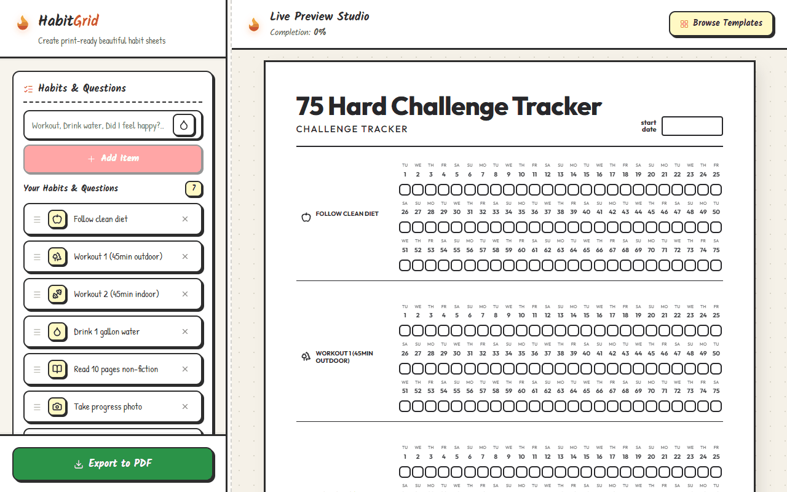

# HabitGrid

**HabitGrid is a free, browser-based habit tracker designer that turns your list of habits into a printable PDF grid you can tick off by hand.**

<p align="center">
  <a href="https://habitgrid.codingmarvel.com"></a>
  
  
  
  
</p>

<p align="center">
  <a href="https://habitgrid.codingmarvel.com/?template=75-hard">
    
  </a>
</p>

Add your habits (or yes/no questions like "Did I feel happy?"), pick a timeframe, style the sheet and export a print-ready PDF. Stick it on the fridge, the mirror or your desk and fill it in with a pen.

**Try it:** [habitgrid.codingmarvel.com](https://habitgrid.codingmarvel.com) · **Templates:** [habitgrid.codingmarvel.com/templates](https://habitgrid.codingmarvel.com/templates)

## Why HabitGrid

- **18 ready-made templates.** 75 Hard, study habits, weight loss, sobriety, sleep, running, kids' chores, new mom self-care and more. One click loads the habits, icons, theme and timeframe.
- **Timeframes up to 150 days.** Track a full calendar month, 1 to 20 consecutive weeks, 5 to 150 days from a start date, or a custom date range up to 150 days.
- **Real print-ready PDFs.** A4 or US Letter, portrait or landscape, zero margins, rendered by headless Chromium from the same HTML and CSS you see in the live preview.
- **Long trackers split across pages for you.** Habits that do not fit on one sheet flow onto the next page under a compact header, marked "(cont.)".
- **7 color themes plus a custom palette,** 3 title fonts and 3 checkbox shapes (square, rounded, circle).
- **No sign-up.** There is no account or login. When you use the plain designer, your habit list and settings autosave in your browser. A `/?template=<slug>` link always opens the template fresh and does not autosave your edits.

## Features

### Habits and icons
- Add as many habits or questions as you need, each up to 30 characters
- Rename any habit inline and drag to reorder (SortableJS)
- Icon picker with 34 curated icons in Health, Mind and Lifestyle groups, plus search across the full [Lucide](https://lucide.dev) icon set

### Timeframes
| Mode | Range |
| --- | --- |
| Specific days count | 5 to 150 days from a start date (default 75) |
| Full calendar month | Any month, years 2020 to 2040 |
| Consecutive weeks | 1 to 20 weeks, starting on a Monday |
| Custom date range | Start and end date, capped at 150 days |

### Design and layout
- Tracker title with Outfit (modern), Playfair Display (elegant) or Abril Fatface (bold)
- Themes: Minimal Monochrome, Warm Sand and Navy, Royal Violet, Mint Emerald, Bright Sunset, Cool Ocean Blue, Wild Lavender, or your own background and accent colors
- Split long rows every 10, 15, 25 or 31 days, or keep one continuous row
- Toggle a start date box, weekday letters, day numbers, a notes and reflections area, and a bottom legend

### Preview and export
- Live preview that updates as you edit, with click-to-tick cells and a completion percentage
- Export to PDF named after your tracker title (for example `75-hard-challenge-tracker.pdf`)

### Template gallery
- A gallery at `/templates` and one page per template at `/templates/<slug>` with habits, tips and FAQs
- Open any template straight in the designer with `/?template=<slug>`, for example [`/?template=study-habits`](https://habitgrid.codingmarvel.com/?template=study-habits)

## How it works

1. The designer (React 19 + TanStack Start) builds paginated A4 or Letter pages in the browser.
2. When you click **Export to PDF**, the page HTML and the active CSS are posted to `/api/generate-pdf`.
3. That server route opens the markup in headless Chromium and calls `page.pdf()` with your page size and orientation, backgrounds on and margins at zero. On Cloudflare it uses [Browser Rendering](https://developers.cloudflare.com/browser-rendering/) through `@cloudflare/playwright`. In local development it launches your installed Chrome or Edge through `playwright-core`.
4. The PDF is streamed back and downloaded.

## Privacy

- **No account and no database.** The repo has no sign-in and no data store.
- **Your designs stay in your browser.** In the plain designer, habits and settings are saved to `localStorage` (key `habit_tracker_designer_state_v8`). A `/?template=<slug>` link always loads the template fresh and does not autosave edits made there. Ticks you click in the preview are not saved and reset on reload.
- **Export sends only the sheet.** The PDF route receives the sheet's HTML and CSS, renders it and returns the file. It does not write the content anywhere.
- Fonts load from Google Fonts.

## Quick start

Requirements: Node.js 20.19+ or 22.12+ (needed by Vite 8), and Chrome or Edge installed if you want PDF export to work locally.

```bash
git clone https://github.com/kyameinsahilwho/habit-grid.git
cd habit-grid
npm install
npm run dev        # http://localhost:3000
```

Other scripts:

```bash
npm run build      # production build (Nitro, cloudflare_module preset)
npm run preview    # preview the production build
npm run generate-routes  # regenerate src/routeTree.gen.ts
```

### Deploying to Cloudflare Workers

The app is built for Cloudflare Workers. `vite.config.ts` uses Nitro's `cloudflare_module` preset and merges `wrangler.jsonc` into the generated deploy config. PDF export needs the Workers **Browser Rendering** binding named `BROWSER`, which `wrangler.jsonc` already declares, along with the `nodejs_compat` flag. To deploy, log in with `npx wrangler login`, then run:

```bash
npm run build
npx wrangler deploy
```

Because `deployConfig: true` is set, the build writes `.output/server/wrangler.json` and a `.wrangler/deploy/config.json` pointer to it, so `npx wrangler deploy` from the project root picks up the built Worker, its static assets and the `BROWSER` binding with no extra flags.

## Tech stack

| Layer | Tools |
| --- | --- |
| UI | React 19, TanStack Router, Tailwind CSS 4, Lucide icons, SortableJS |
| Framework | TanStack Start, Vite 8, Nitro |
| PDF rendering | Cloudflare Browser Rendering (`@cloudflare/playwright`), `playwright-core` for local dev |
| Hosting | Cloudflare Workers (Wrangler) |
| Language | TypeScript |

### Project layout

```
src/
  routes/index.tsx            designer page (accepts ?template=<slug>)
  routes/templates/           template gallery and /templates/$slug pages
  routes/api/generate-pdf.ts  POST endpoint that renders the PDF
  components/                 HabitDesigner, Sidebar, PreviewCanvas, IconPicker, ...
  lib/templates.ts            the 18 template definitions
  lib/gridUtils.ts            date grid and theme presets
  lib/pagination.ts           splits habits across printable pages
public/
  templates/                  static HTML versions of the template pages
  sitemap.xml, robots.txt
```

## FAQ

### Is HabitGrid free?
Yes. HabitGrid is free to use at [habitgrid.codingmarvel.com](https://habitgrid.codingmarvel.com), with no account, sign-up or paywall.

### Does HabitGrid save or upload my habits?
In the plain designer, your habits and settings are saved only in your browser's `localStorage` (edits made on a `/?template=<slug>` link are not autosaved). When you export, the sheet's HTML and CSS are sent to the app's PDF endpoint to be rendered, and the PDF comes straight back to you.

### How do I make a printable 75 Hard tracker?
Open the [75 Hard template](https://habitgrid.codingmarvel.com/?template=75-hard), which loads 7 daily tasks on a 75-day grid, edit anything you like and click **Export to PDF** in the same session. Template links always open the template fresh, so edits made there are not saved for your next visit.

### What paper sizes does HabitGrid support?
A4 and US Letter, each in portrait or landscape. Long trackers are split across as many pages as needed.

### Can I track a custom number of days or a date range?
Yes. Choose "Specific Days Count" for 5 to 150 days, "Consecutive Weeks" for 1 to 20 weeks, a full calendar month, or "Custom Date Range" for any span up to 150 days.

### Can I self-host HabitGrid?
Yes. Clone the repo, run `npm install` and `npm run dev` to use it locally, or deploy it to Cloudflare Workers with a Browser Rendering binding named `BROWSER` for PDF export.

## Part of CodingMarvel

HabitGrid is one of the free tools in the [CodingMarvel](https://codingmarvel.com) collection.

**More from CodingMarvel**

- [Ehmatrix](https://ehmatrix.codingmarvel.com): Eisenhower matrix to-do list
- [Pollytasks](https://pollytasks.codingmarvel.com): gamified tasks and habits
- [Love for PDF](https://pdf.codingmarvel.com): 35+ PDF tools in your browser
- [Video Grid Maker](https://video-grid-maker.codingmarvel.com): video contact sheets
- [Platter](https://github.com/kyameinsahilwho/platter): Windows disk utility in Rust
- [MAX File Recovery](https://github.com/kyameinsahilwho/ReincarnateMax): Windows data recovery in Rust
- [Chrome extensions](https://github.com/kyameinsahilwho/cool-chrome-extensions)
